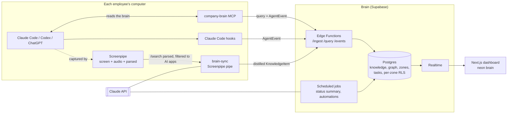

# MVP architecture — Company brain

See [IDEA.md](IDEA.md) for the product. This document describes the **how** and **who does what**.

## Guiding principle

**The raw data stays on the computer, only the distilled knowledge goes up to the brain.**
Screenpipe records everything locally (~19 GB / 2 weeks). On each computer, an agent extracts only the AI sessions, distills them into "knowledge" (a few KB/day) and sends it to the shared brain. That solves storage, context saturation and a good part of GDPR at the same time.

## Overview



**Key loop for the demo:** an employee works with Claude Code → Screenpipe captures → `brain-sync` distills → the brain grows. When an agent (anyone's) needs context, it queries the brain through the MCP → the zone concerned **lights up in neon** on the dashboard.

## Stack

| Block | Choice | Why |
|---|---|---|
| Capture | **Screenpipe** (local) | Required by the hackathon. `/search?content_type=parsed` already gives the Claude conversations structured (user/assistant messages). |
| Local agent | **Screenpipe pipe** `brain-sync` (scheduled every 15-30 min) | Runs inside Screenpipe, has access to the local API and the token. Fallback: a Bun script run by cron. |
| Distillation | **Claude API**: `claude-haiku-5-5` to sort/classify, `claude-sonnet-5-5` to extract and summarize | Haiku is cheap on volume, Sonnet is kept for quality. |
| Backend | **Supabase**: Postgres, Auth, **RLS**, **Realtime**, Edge Functions | RLS = per-zone access without writing code. Realtime = live neons. The Supabase MCP is already connected here. |
| Search | Postgres full-text first, **pgvector** if there is time | FTS is enough for the demo, fewer moving parts. |
| Reading by agents | **`company-brain` MCP server** (TypeScript, stdio) | Claude Code queries the brain, and each request emits an `AgentEvent`. |
| Agent events | **Claude Code hooks** (`SessionStart`, `UserPromptSubmit`, `Stop`) → `POST /events` | Makes the neons reliable, without depending on screen capture. |
| Dashboard | **Next.js + Tailwind**, viz with **react-force-graph** (or an SVG brain split into zones), deployed on Vercel | Quick to build, strong visual effect. |
| Automations | **Screenpipe Workflows** (`list-workflows` / `/workflows`) + home-made heuristic | Screenpipe already detects repeated workflows locally, we send them up as suggestions. |

## Data model (contract between the teams)

To freeze **first**: everyone codes against these formats, with mocks if needed.

```ts
// What brain-sync sends to the brain
type KnowledgeItem = {
  org_id: string
  author_id: string            // the employee the session comes from
  zone: string                 // "dev" | "finance" | "sales" | "product" | …
  kind: "fact" | "decision" | "task" | "procedure" | "question"
  title: string
  body: string                 // distilled, never a raw capture
  entities: { type: "person" | "project" | "client" | "tool" | "doc"; name: string }[]
  source: { app: string; tool: "claude-code" | "codex" | "chatgpt" | "meeting" | "onboarding"; at: string; screenpipe_ref?: string }
  confidence: number           // 0-1
}

// What makes the brain light up
type AgentEvent = {
  org_id: string
  user_id: string
  agent: "claude-code" | "codex" | "brain-sync" | "job"
  type: "started" | "query" | "write" | "stopped"
  zones: string[]
  summary?: string             // "looks for the monthly closing procedure"
  at: string
}
```

**Supabase tables**: `orgs`, `profiles` (role), `zones`, `zone_access` (user ↔ zone, read/write), `knowledge_items`, `entities`, `edges` (graph: item ↔ entity, entity ↔ entity), `agent_events`, `tasks`, `automation_suggestions`, `company_status` (generated summary), `skills` (the company's Claude Code skills and their scripts, assigned to a cortex = a zone).
**RLS**: a user only reads `knowledge_items` if `zone ∈ zone_access(user)`. Admins see everything.

## The flows in detail

### 1. Company onboarding
1. The admin creates the org on the dashboard.
2. **5-10 min interview**: chat (or voice) with Claude, which asks guided questions (activity, teams, tools, goals, links).
3. The links provided are **scraped** and distilled into `KnowledgeItem`s.
4. Claude proposes **the initial zones** and the first knowledge, which the admin validates.
5. *(Stretch)* Notion and Calendar connectors.

### 2. Employee onboarding (the "magic prompt")
The admin invites someone → the person receives **a prompt to paste into Claude Code**, which runs a single command:
`install.sh` (macOS, Linux) or `install.ps1` (Windows) finds or installs Node.js, downloads the client and runs
`brain.mjs setup` (details, exit codes and permissions: [install/PROMPT.md](install/PROMPT.md), why a CLI:
[docs/CLI.md](docs/CLI.md)):
- installs and starts Screenpipe if it is missing (official CLI as a service, microphone off), then gets the local token;
- opens the right macOS Settings and resumes on its own as soon as Screen Recording (and Accessibility, optional) is granted;
- adds the `company-brain` MCP and the hooks to the Claude Code config, schedules `brain-sync` every 15 min;
- runs an end-to-end test (a "hello" event that lights up) and opens the dashboard already signed in (2-min sign-in link);
- if something gets stuck, `brain doctor` reviews the computer without changing anything and gives the command that repairs.

### 3. Capture → brain (`brain-sync`, every 15-30 min)
1. `GET /search?content_type=parsed&start_time=<last checkpoint>` filtered to AI apps (Claude, Terminal/iTerm for Claude Code, Codex, ChatGPT/Claude browser tabs), with an `accessibility` fallback.
2. **Privacy filter**: app allowlist, removal of personal content, redaction of secrets/emails/numbers.
3. Haiku: "does this contain reusable knowledge?" + zone.
4. Sonnet: extraction into `KnowledgeItem[]` + entities.
5. `POST /ingest`, then the checkpoint moves forward. An `AgentEvent{agent:"brain-sync", type:"write"}` is emitted.

### 4. Reading by agents (`company-brain` MCP)
Tools: `search_brain(query, zones?)`, `get_zone_summary(zone)`, `whoami_context()` (the computer's context, useful for handover).
Each call goes through `/query` (RLS applied with the user's token) and emits an `AgentEvent{type:"query"}` → neon.

### 5. Scheduled jobs (cloud)
- **Company status** (daily + "refresh" button): Sonnet summarizes per zone the goals, progress, next steps and who did what.
- **New zones** (every day at 10 am: Vercel Cron with the company's Claude API key, or `brain refresh-zones` in the company's GitHub CI with its Claude Code subscription): Claude rereads each company's knowledge of the last 30 days and creates, without approval, the zone of a recurring area that has none; its knowledge is filed in it and read access follows (`apps/web/lib/new-zones.ts`).
- **Automations**: sends up the workflows detected by Screenpipe + the heuristic "same prompt, same person, same time slot, ≥ 3 days" → `automation_suggestions` shown to the leaders.

## Split for the team (4 people, adaptable to 3)

Everyone moves forward in parallel with the contracts above and mocks. We integrate at milestone 3.

| Role | Scope | Demo deliverable |
|---|---|---|
| **A — Capture** | `brain-sync` pipe, distillation prompts, privacy filter, Claude Code hooks, **install prompt** | A real Claude Code session becomes `KnowledgeItem`s in less than 15 min |
| **B — Brain** | Supabase schema + RLS, `/ingest` `/query` `/events` Edge Functions, `company-brain` MCP server, data seed | An agent queries the brain, with access rights respected per zone |
| **C — Dashboard** | Next.js: brain viz + **Realtime neons**, accounts and per-zone access, tasks view | The brain lights up live during the demo |
| **D — Intelligence & demo** | Onboarding interview + scraping, "company status" summary, automation suggestions, **demo script and pitch** | Onboarding in 5 min + the "where does the company stand" screen |

With 3 people: D is split between A (automations) and C (onboarding + status).

### Milestones
1. **Contracts frozen**: `KnowledgeItem` / `AgentEvent` types, SQL schema, shared Supabase URL. *Everyone together, briefly.*
2. **Everyone solo with mocks**: A sends to a mock endpoint, C reads seeded data, B exposes the API.
3. **Integration**: real end-to-end pipeline on 2-3 of the team's laptops (one in "dev", one in "finance", one in "sales").
4. **Demo**: seed of a credible fake company + rehearsed script.

## Demo script (target)
1. Onboarding of a fictitious company: quick interview → the brain appears with its zones.
2. An employee pastes the magic prompt into Claude Code → their neon lights up.
3. They code with Claude → a few minutes later, the "dev" zone grows.
4. Finance asks a question through its agent → only the finance zone lights up; the code stays invisible to it (RLS).
5. "Company status" screen + an automation suggestion ("Jean-Marc runs this prompt every day at 9 am").

## Risks and countermeasures
- **Slow capture during the demo** → "sync now" button on `brain-sync`, and direct reading of the Claude Code logs (`~/.claude/projects/*.jsonl`) as a backup source.
- **Quality of `parsed`** (experimental) → fallback on `accessibility`, deduplicating the repeated chat history.
- **Privacy** → app allowlist, nothing raw leaves the computer, the employee can see and delete their items.
- **LLM cost** → Haiku as the first filter, Sonnet only on what passes the filter.

## MVP implementation (what is built)

The code follows the contracts above (`KnowledgeItem`, `AgentEvent`, tables) with a few pragmatic choices, so that everything runs on a single laptop as well as on Supabase:

| Planned | Built | Why |
|---|---|---|
| `/ingest` `/query` `/events` Edge Functions | Next.js API routes (`apps/web/app/api/*`), same contracts | A single deployment (Vercel or laptop), testable locally without Deno. |
| Supabase Realtime | SSE stream `/api/stream` that rereads `agent_events` | Also works with the file storage and on several instances; the Realtime publication is still enabled by the RLS migration. |
| Supabase Postgres only | Two storages behind the same interface: JSON file (zero-config demo) or Postgres (`DATABASE_URL`, Supabase or another) | The demo does not depend on the network; the shared brain uses Supabase. |
| Per-zone RLS | Rule applied by the API on every route (`lib/access.ts`) **and** SQL RLS policies (`supabase/migrations/*_rls.sql`) for direct access | The API connects with the owner role; the policies protect any direct access (anon key, Supabase Auth through `profiles.auth_user_id`). |
| Supabase Auth | Personal token per employee (hashed with SHA-256) for agents + signed session cookie for the dashboard; "view as" for admins | The same token serves the install prompt, the MCP, the hooks and brain-sync. |
| `brain-sync` Screenpipe pipe | Single client `brain.mjs` (`apps/client`): `sync`, `mcp`, `hook`, `install-*`, scheduled by launchd / cron / schtasks | A single file downloaded from the dashboard, without `npm install` on the computer. Screenpipe is read through its local REST API; the local Claude Code logs are the most reliable source. |
| Haiku then Sonnet | `claude-haiku-5-5` triage + `claude-sonnet-5-5` extraction (structured outputs, server fallback on refusal) if an API key is present; otherwise `claude -p` (the employee's Claude Code subscription); otherwise a local heuristic | Distillation works even without an API key. |
| FTS then pgvector | Postgres FTS (`simple`, normalized text without accents, title/body weighting); token score in file mode | Enough for the demo. pgvector stays the next step. |
| react-force-graph | Home-made SVG: two hemispheres split into zones (Voronoi), neurons = entities, synapses = shared entities | Controlled "neon" effect, readable in a demo. |

Automation detection: the hooks send a **fingerprint** of the normalized prompt (dates and numbers neutralized) and a redacted 160-character summary. A suggestion is born when the same person runs the same prompt on at least 3 days, with at least 80% of the days within ±40 min of the median time (`BRAIN_TIMEZONE` time zone, Europe/Paris by default). The workflows detected by Screenpipe can also be sent up (`POST /api/automations`).

Sync robustness: each source keeps its checkpoint and its pending conversations. An outage (subscription limit, overload, network, expired token) is never counted against a conversation; a conversation is only given up after 3 proven failures (or 5 attempts over 24 h if Claude does not answer at all any more), so that the checkpoint moves forward without losing data on a mere outage.

Next steps: Notion / Calendar / Todoist connectors, pgvector, voice onboarding interview, consent and retention period (GDPR), real execution of the approved automations.
