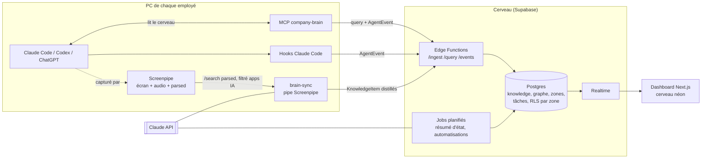

# Architecture du MVP — Cerveau d'entreprise

Voir [IDEA.md](IDEA.md) pour le produit. Ce document décrit le **comment** et **qui fait quoi**.

## Principe directeur

**Le brut reste sur le PC, seul le distillé monte au cerveau.**
Screenpipe enregistre tout en local (~19 Go / 2 semaines). Sur chaque poste, un agent extrait uniquement les sessions IA, les distille en « connaissances » (quelques Ko/jour) et les envoie au cerveau partagé. Ça règle en même temps le stockage, la saturation du contexte et une bonne partie du RGPD.

## Vue d'ensemble



**Boucle clé pour la démo :** un employé travaille avec Claude Code → Screenpipe capte → `brain-sync` distille → le cerveau grossit. Quand un agent (de n'importe qui) a besoin de contexte, il interroge le cerveau via le MCP → la zone concernée **s'allume en néon** sur le dashboard.

## Stack

| Brique | Choix | Pourquoi |
|---|---|---|
| Capture | **Screenpipe** (local) | Imposé par le hackathon. `/search?content_type=parsed` donne déjà les conversations Claude structurées (messages user/assistant). |
| Agent local | **Pipe Screenpipe** `brain-sync` (planifié toutes les 15-30 min) | Tourne dans Screenpipe, a accès à l'API locale et au token. Fallback : un script Bun lancé en cron. |
| Distillation | **Claude API** : `claude-haiku-5-5` pour trier/classer, `claude-sonnet-5-5` pour extraire et résumer | Haiku est peu cher sur le volume, Sonnet est réservé à la qualité. |
| Backend | **Supabase** : Postgres, Auth, **RLS**, **Realtime**, Edge Functions | RLS = accès par zone sans rien coder. Realtime = néons en direct. Le MCP Supabase est déjà branché ici. |
| Recherche | Full-text Postgres d'abord, **pgvector** si on a le temps | Le FTS suffit pour la démo, moins de pièces mobiles. |
| Lecture par les agents | **Serveur MCP `company-brain`** (TypeScript, stdio) | Claude Code interroge le cerveau, et chaque requête émet un `AgentEvent`. |
| Événements agents | **Hooks Claude Code** (`SessionStart`, `UserPromptSubmit`, `Stop`) → `POST /events` | Rend les néons fiables, sans dépendre de la capture d'écran. |
| Dashboard | **Next.js + Tailwind**, viz avec **react-force-graph** (ou SVG de cerveau découpé en zones), déployé sur Vercel | Rapide à monter, effet visuel fort. |
| Automatisations | **Screenpipe Workflows** (`list-workflows` / `/workflows`) + heuristique maison | Screenpipe détecte déjà les workflows répétés en local, on les remonte comme suggestions. |

## Modèle de données (contrat entre les équipes)

À figer **en premier** : tout le monde code contre ces formats, avec des mocks si besoin.

```ts
// Ce que brain-sync envoie au cerveau
type KnowledgeItem = {
  org_id: string
  author_id: string            // l'employé dont la session vient
  zone: string                 // "dev" | "compta" | "sales" | "produit" | …
  kind: "fact" | "decision" | "task" | "procedure" | "question"
  title: string
  body: string                 // distillé, jamais de capture brute
  entities: { type: "person" | "project" | "client" | "tool" | "doc"; name: string }[]
  source: { app: string; tool: "claude-code" | "codex" | "chatgpt" | "meeting" | "onboarding"; at: string; screenpipe_ref?: string }
  confidence: number           // 0-1
}

// Ce qui fait s'allumer le cerveau
type AgentEvent = {
  org_id: string
  user_id: string
  agent: "claude-code" | "codex" | "brain-sync" | "job"
  type: "started" | "query" | "write" | "stopped"
  zones: string[]
  summary?: string             // "cherche la procédure de clôture mensuelle"
  at: string
}
```

**Tables Supabase** : `orgs`, `profiles` (rôle), `zones`, `zone_access` (user ↔ zone, lecture/écriture), `knowledge_items`, `entities`, `edges` (graphe : item ↔ entité, entité ↔ entité), `agent_events`, `tasks`, `automation_suggestions`, `company_status` (résumé généré).
**RLS** : un utilisateur ne lit `knowledge_items` que si `zone ∈ zone_access(user)`. Les admins voient tout.

## Les flux en détail

### 1. Onboarding entreprise
1. L'admin crée l'org sur le dashboard.
2. **Interview de 5-10 min** : chat (ou voix) avec Claude, qui pose des questions guidées (activité, équipes, outils, objectifs, liens).
3. Les liens fournis sont **scrapés** et distillés en `KnowledgeItem`.
4. Claude propose **les zones initiales** et les premières connaissances, que l'admin valide.
5. *(Stretch)* Connecteurs Notion et Calendar.

### 2. Onboarding employé (le « prompt magique »)
L'admin invite quelqu'un → la personne reçoit **un prompt à coller dans Claude Code**, qui lance une seule commande,
`brain.mjs setup` (détail et autorisations : [install/PROMPT.md](install/PROMPT.md)) :
- installe et lance Screenpipe s'il est absent (CLI officiel en service, micro coupé), puis récupère le token local ;
- ouvre les bons Réglages macOS et reprend tout seul dès que l'Enregistrement de l'écran (et l'Accessibilité, facultative) est accordé ;
- ajoute le MCP `company-brain` et les hooks dans la config Claude Code, planifie `brain-sync` toutes les 15 min ;
- fait un test de bout en bout (un événement « hello » qui s'allume) et ouvre le dashboard déjà connecté (lien de connexion de 2 min).

### 3. Capture → cerveau (`brain-sync`, toutes les 15-30 min)
1. `GET /search?content_type=parsed&start_time=<dernier checkpoint>` filtré sur les apps IA (Claude, Terminal/iTerm pour Claude Code, Codex, onglets ChatGPT/Claude du navigateur), avec un fallback `accessibility`.
2. **Filtre vie privée** : liste blanche d'apps, suppression des contenus perso, masquage des secrets/emails/numéros.
3. Haiku : « est-ce que ça contient de la connaissance réutilisable ? » + zone.
4. Sonnet : extraction en `KnowledgeItem[]` + entités.
5. `POST /ingest`, puis on avance le checkpoint. Un `AgentEvent{agent:"brain-sync", type:"write"}` est émis.

### 4. Lecture par les agents (MCP `company-brain`)
Outils : `search_brain(query, zones?)`, `get_zone_summary(zone)`, `whoami_context()` (le contexte du poste, utile pour la passation).
Chaque appel passe par `/query` (RLS appliquée avec le token de l'utilisateur) et émet un `AgentEvent{type:"query"}` → néon.

### 5. Jobs planifiés (cloud)
- **État de l'entreprise** (quotidien + bouton « rafraîchir ») : Sonnet résume par zone les objectifs, l'avancement, les prochaines étapes et qui a fait quoi.
- **Automatisations** : remonte les workflows détectés par Screenpipe + heuristique « même prompt, même personne, même créneau, ≥ 3 jours » → `automation_suggestions` affichées aux dirigeants.

## Découpage pour l'équipe (4 personnes, adaptable à 3)

Chacun avance en parallèle avec les contrats ci-dessus et des mocks. On intègre au jalon 3.

| Rôle | Périmètre | Livrable de démo |
|---|---|---|
| **A — Capture** | Pipe `brain-sync`, prompts de distillation, filtre vie privée, hooks Claude Code, **prompt d'installation** | Une vraie session Claude Code devient des `KnowledgeItem` en moins de 15 min |
| **B — Cerveau** | Schéma Supabase + RLS, Edge Functions `/ingest` `/query` `/events`, serveur MCP `company-brain`, seed de données | Un agent interroge le cerveau, avec des droits respectés par zone |
| **C — Dashboard** | Next.js : viz du cerveau + **néons Realtime**, comptes et accès par zone, vue tâches | Le cerveau s'allume en direct pendant la démo |
| **D — Intelligence & démo** | Interview d'onboarding + scraping, résumé « état de l'entreprise », suggestions d'automatisation, **script de démo et pitch** | L'onboarding en 5 min + l'écran « où en est la boîte » |

À 3 personnes : D se répartit entre A (automatisations) et C (onboarding + état).

### Jalons
1. **Contrats figés** : types `KnowledgeItem` / `AgentEvent`, schéma SQL, URL Supabase partagée. *Tout le monde ensemble, en court.*
2. **Chacun en solo avec des mocks** : A envoie vers un endpoint mock, C lit des données seedées, B expose l'API.
3. **Intégration** : vrai pipeline de bout en bout sur 2-3 laptops de l'équipe (un en « dev », un en « compta », un en « sales »).
4. **Démo** : seed d'une fausse entreprise crédible + script répété.

## Script de démo (cible)
1. Onboarding d'une entreprise fictive : interview express → le cerveau apparaît avec ses zones.
2. Un employé colle le prompt magique dans Claude Code → son néon s'allume.
3. Il code avec Claude → quelques minutes plus tard, la zone « dev » grossit.
4. La compta pose une question via son agent → seule la zone compta s'allume ; le code lui reste invisible (RLS).
5. Écran « état de l'entreprise » + une suggestion d'automatisation (« Jean-Marc lance ce prompt tous les jours à 9h »).

## Risques et parades
- **Capture lente pendant la démo** → bouton « sync maintenant » sur `brain-sync`, et lecture directe des logs Claude Code (`~/.claude/projects/*.jsonl`) en source de secours.
- **Qualité de `parsed`** (expérimental) → fallback sur `accessibility`, en dédupliquant l'historique de chat répété.
- **Vie privée** → liste blanche d'apps, rien de brut ne quitte le PC, l'employé peut voir et supprimer ses items.
- **Coût LLM** → Haiku en premier filtre, Sonnet seulement sur ce qui passe le filtre.

## Implémentation du MVP (ce qui est construit)

Le code suit les contrats ci-dessus (`KnowledgeItem`, `AgentEvent`, tables) avec quelques choix pragmatiques, pour que tout tourne sur un seul laptop comme sur Supabase :

| Prévu | Construit | Pourquoi |
|---|---|---|
| Edge Functions `/ingest` `/query` `/events` | Routes API Next.js (`apps/web/app/api/*`), mêmes contrats | Un seul déploiement (Vercel ou laptop), testable localement sans Deno. |
| Supabase Realtime | Flux SSE `/api/stream` qui relit `agent_events` | Marche aussi avec le stockage fichier et sur plusieurs instances ; la publication Realtime est quand même activée par la migration RLS. |
| Postgres Supabase uniquement | Deux stockages derrière la même interface : fichier JSON (démo zéro config) ou Postgres (`DATABASE_URL`, Supabase ou autre) | La démo ne dépend pas du réseau ; le cerveau partagé utilise Supabase. |
| RLS par zone | Règle appliquée par l'API sur toutes les routes (`lib/access.ts`) **et** politiques RLS SQL (`supabase/migrations/*_rls.sql`) pour l'accès direct | L'API se connecte avec le rôle propriétaire ; les politiques protègent tout accès direct (clé anon, Supabase Auth via `profiles.auth_user_id`). |
| Supabase Auth | Jeton personnel par employé (haché SHA-256) pour les agents + cookie de session signé pour le dashboard ; « voir en tant que » pour les admins | Le même jeton sert au prompt d'installation, au MCP, aux hooks et à brain-sync. |
| Pipe Screenpipe `brain-sync` | Client unique `brain.mjs` (`apps/client`) : `sync`, `mcp`, `hook`, `install-*`, planifié par launchd / cron / schtasks | Un seul fichier téléchargé depuis le dashboard, sans `npm install` sur le poste. Screenpipe est lu via son API REST locale ; les logs Claude Code locaux sont la source la plus fiable. |
| Haiku puis Sonnet | Tri `claude-haiku-5-5` + extraction `claude-sonnet-5-5` (sorties structurées, repli serveur en cas de refus) si une clé API est présente ; sinon `claude -p` (abonnement Claude Code de l'employé) ; sinon heuristique locale | La distillation marche même sans clé API. |
| FTS puis pgvector | FTS Postgres (`simple`, texte normalisé sans accents, pondération titre/corps) ; score par tokens en mode fichier | Suffisant pour la démo. pgvector reste l'étape suivante. |
| react-force-graph | SVG maison : deux hémisphères découpés en zones (Voronoï), neurones = entités, synapses = entités partagées | Effet « néon » maîtrisé et lisible en démo. |

Détection d'automatisations : les hooks envoient une **empreinte** du prompt normalisé (dates et nombres neutralisés) et un résumé masqué de 160 caractères. Une suggestion naît quand la même personne lance le même prompt sur au moins 3 jours, avec au moins 80 % des journées à ±40 min de l'heure médiane (fuseau `BRAIN_TIMEZONE`, Europe/Paris par défaut). Les workflows détectés par Screenpipe peuvent aussi être remontés (`POST /api/automations`).

Robustesse de la synchro : chaque source garde son checkpoint et les conversations en attente. Une panne (limite d'abonnement, surcharge, réseau, jeton expiré) n'est jamais comptée contre une conversation ; une conversation n'est abandonnée qu'après 3 échecs avérés (ou 5 essais sur 24 h si Claude ne répond plus du tout), pour que le checkpoint avance sans perdre de données sur une simple panne.

Étapes suivantes : connecteurs Notion / Calendar / Todoist, pgvector, interview d'onboarding vocale, consentement et durée de conservation (RGPD), exécution réelle des automatisations validées.
