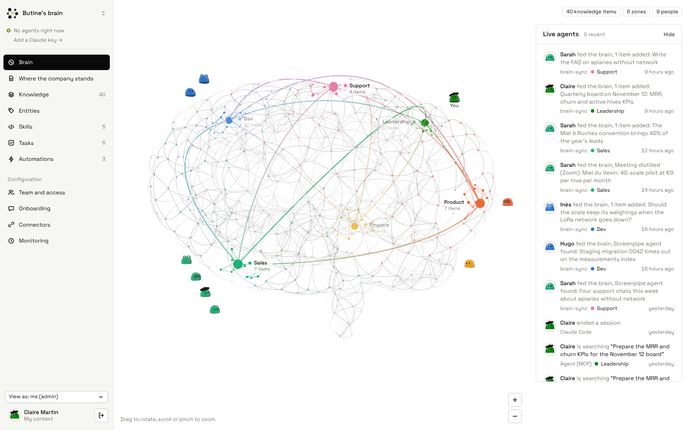
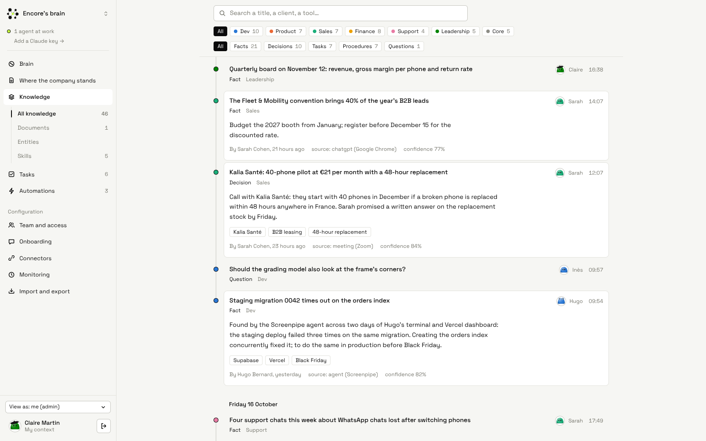
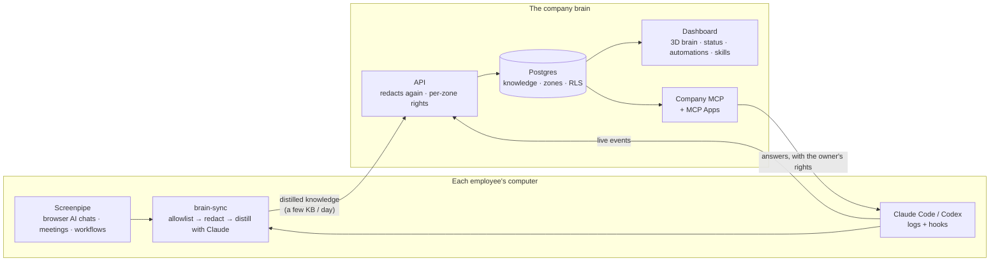
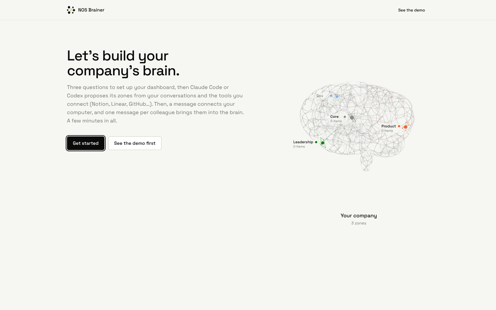
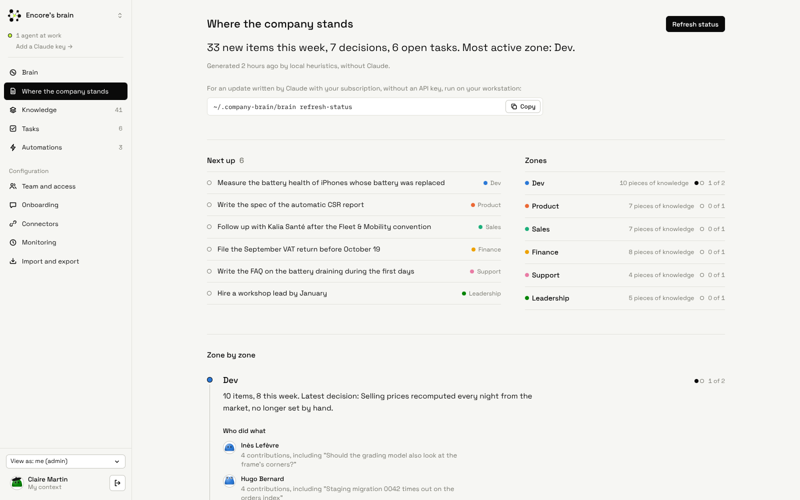
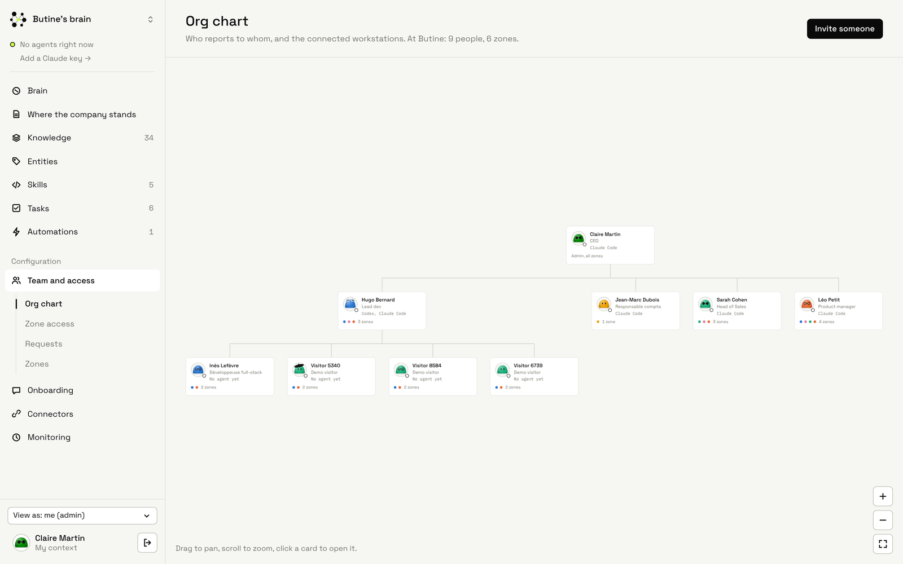
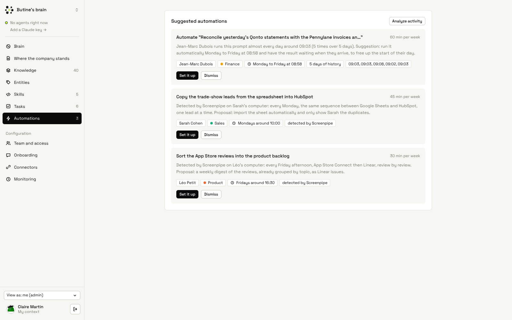

<p align="center">
  
</p>

<h1 align="center">NOS Brainer</h1>

<p align="center">
  <strong>The company brain that is a <em>no-brainer</em>.</strong><br/>
  Screenpipe remembers for one person. NOS Brainer turns what every computer remembers<br/>
  into one brain the whole company, and every AI agent in it, can use.
</p>

<p align="center">
  <a href="https://www.nos-brainer.tech/demo"><strong>Live demo</strong></a> &middot;
  <a href="https://www.nos-brainer.tech/create"><strong>Create your brain</strong></a> &middot;
  <a href="#quickstart"><strong>Quickstart</strong></a> &middot;
  <a href="ARCHITECTURE.md"><strong>Architecture</strong></a> &middot;
  <a href="docs/REFERENCE.md"><strong>Reference</strong></a> &middot;
  <a href="demo/DEMO.md"><strong>Demo script</strong></a>
</p>

<p align="center">
  
  
  
  
</p>

<br/>

<p align="center">
  
</p>

<p align="center">
  <a href="https://www.nos-brainer.tech/demo"><strong>Open the live demo →</strong></a> sign in as <em>Claire Martin, CEO</em> to see everything,
  then <em>"View as: Jean-Marc"</em> to see what finance sees.
</p>

<br/>

## If Screenpipe is a person's memory, NOS Brainer is the company's.

Every employee already works with AI: Claude Code and Codex for developers, ChatGPT or Claude in the browser for sales,
finance and product, plus the meetings where decisions get made. NOS Brainer plugs **Screenpipe** into every computer,
**distills** what people learn into decisions, procedures and facts, and puts it in **one shared brain** that every
agent in the company can query, with the rights of its owner.

**Paste one prompt. Work as usual. Every agent knows what the team knows.**

|        | Step                    | What happens                                                                                                           |
| ------ | ----------------------- | ---------------------------------------------------------------------------------------------------------------------- |
| **01** | **Paste one prompt**    | An admin invites a colleague. They paste the prompt into Claude Code: Screenpipe, the company MCP, hooks and sync are installed in one command. |
| **02** | **Work as usual**       | Every 15 minutes, `brain-sync` reads Screenpipe and the agent logs, strips secrets and personal content, and sends only distilled knowledge. |
| **03** | **Every agent knows**   | Anyone's Claude Code, Codex or Claude asks the brain through MCP. The zone it reads lights up live on the dashboard.  |

<br/>

## The problem

AI made every employee faster, and the company **more forgetful**.

- 🔒 **Knowledge is locked in sessions.** When Hugo figures out why the staging deploy fails, or Jean-Marc fine-tunes his
  bank reconciliation with ChatGPT, that knowledge dies with the chat tab. The next person, and the next agent, starts
  from zero.
- 🙈 **Most of the work leaves no log.** Browser AI chats, Zoom calls, dashboards: no hook or log file sees them. A brain
  built only on coding-agent logs hears the developers and nobody else.
- 🗄️ **Screenpipe solves memory for one person, not a team.** Its own spec says it: *"sqlite does not federate, 30
  employees = 30 dbs, not one queryable org brain."* And each of those databases weighs ~19 GB every two weeks.
- 🚧 **Sharing naively is a non-starter.** Nobody will pipe raw screen captures into a shared store, and finance has no
  business reading the code context, and neither do its agents.
- 🔁 **Nobody sees the patterns.** One computer sees one habit. The prompt Jean-Marc runs every morning, the leads Sarah
  copies by hand every Monday: worth automating, invisible to the team.

**NOS Brainer is the missing layer:** the raw capture stays on each computer, only distilled knowledge goes up, and
the brain enforces who reads what.

<br/>

## Problems NOS Brainer solves

| Without NOS Brainer                                                                                         | With NOS Brainer                                                                                                              |
| ----------------------------------------------------------------------------------------------------------- | ----------------------------------------------------------------------------------------------------------------------------- |
| ❌ Hugo spends two days on a failing staging migration. The fix lives in his terminal history.               | ✅ The Screenpipe agent spots it, it lands in the **Dev** zone, and the next developer's Claude Code finds it through MCP.     |
| ❌ "We freeze Black Friday prices on Nov 17" was decided on Monday's Zoom. It only exists in people's heads.  | ✅ Screenpipe transcribes the meeting; it becomes a **decision** in the brain, with who said it and when.                      |
| ❌ Sales answers a tricky VAT question with ChatGPT in Chrome. No log, no hook: invisible.                    | ✅ Screenpipe's semantic parser turns the browser chat into a conversation, distilled exactly like a Claude Code session.      |
| ❌ 30 employees, 30 local databases, ~19 GB each every two weeks. Nothing queryable at company level.         | ✅ A few KB of distilled knowledge per computer per day, in one brain the whole company can search.                           |
| ❌ A shared memory means everyone, and every agent, reads everything.                                        | ✅ **Per-zone access**, enforced on every route and in Postgres RLS. Agents inherit their owner's rights through their token. |
| ❌ The same prompt every morning, the same copy-paste every Monday. Nobody notices.                          | ✅ Repeated prompts and Screenpipe workflows become **automation suggestions** in one place, set up by an admin.             |
| ❌ Someone goes on leave and their context goes with them.                                                   | ✅ A **handover page**: their zones, tools, recurring prompts and knowledge, ready for whoever replaces them.                 |
| ❌ Rolling a tool out to 18 computers takes a day of IT tickets.                                             | ✅ **One prompt** in Claude Code. If something is stuck, `brain doctor` says what and gives the command that fixes it.        |

<br/>

## What only Screenpipe sees

Screenpipe is the sensor on every computer, and the reason the brain hears more than developers. Without it, only the
coding agents that write log files would feed it: no browser AI chats, no meetings, no workflows.

<p align="center">
  
</p>

<p align="center"><sub>In the demo company (fictitious data): an answer found with ChatGPT in Chrome, a Zoom call with a customer, and what the Screenpipe agent found in a developer's terminal and Vercel dashboard. No log file holds any of it.</sub></p>

| Screenpipe capability          | How NOS Brainer uses it                                                                                                                                        | Code                                      |
| ------------------------------ | -------------------------------------------------------------------------------------------------------------------------------------------------------------- | ----------------------------------------- |
| **Installed by the prompt**    | `brain setup` installs and starts Screenpipe, opens the macOS Screen Recording pane at the right place, waits for the first frames, reads the local API token. | `apps/client/src/setup.ts`                |
| **AI chats with no logs**      | `/search` with the semantic parser (`parsed` items, resolved speakers), accessibility text, OCR as fallback, `filter_pii=true`, app allowlist, `browser_url`: ChatGPT, Claude.ai and Gemini in the browser become conversations. | `apps/client/src/sources/screenpipe.ts`   |
| **Meetings**                   | `/meetings` and their transcripts become conversations, so decisions and commitments reach the brain (microphone off by default).                                | `readScreenpipeMeetings`                  |
| **A Screenpipe agent**         | On each sync, Claude Code or Codex explores recent activity itself through the Screenpipe MCP (read-only tools) and proposes knowledge, through the same filters. | `apps/client/src/agent.ts`                |
| **Workflows worth automating** | Screenpipe's detected workflows (occurrences, days, usual time, minutes per week) are sent up and shown to admins as automation suggestions, next to the repeated prompts. | `fetchScreenpipeWorkflows`                |
| **Every 15 minutes**           | The scheduled sync (launchd, cron or Task Scheduler) reads Screenpipe from its checkpoint, so nothing is read twice and no old history is sent by surprise.          | `apps/client/src/install.ts`              |
| **Privacy by design**          | The raw capture never leaves the computer; `sync --dry-run --full` shows exactly what would be sent.                                                            | `apps/client/src/sync.ts`                 |

<br/>

## Features

<table>
<tr>
<td align="center" width="33%">
<h3>🪄 One prompt to join</h3>
Paste it into Claude Code: Screenpipe, permissions, company MCP, hooks and a 15-minute sync, in one command. macOS, Linux and Windows.
</td>
<td align="center" width="33%">
<h3>🧪 Distilled, never raw</h3>
Secrets, emails, IBANs and personal content are stripped on the computer, then again on the server. Claude turns the rest into decisions, procedures, facts and tasks.
</td>
<td align="center" width="33%">
<h3>🧠 One brain, per-zone access</h3>
Knowledge lands in zones (Dev, Sales, Finance…). Finance never sees the Dev zone, and neither do its agents.
</td>
</tr>
<tr>
<td align="center">
<h3>🔌 Every agent plugged in</h3>
A company MCP server for Claude Code and Codex, and <strong>MCP Apps</strong> that open the live brain, automations and org chart inside Claude.
</td>
<td align="center">
<h3>✨ A live 3D brain</h3>
Zones light up in neon as agents learn and ask, with a live feed of what is happening across the company.
</td>
<td align="center">
<h3>📍 Where the company stands</h3>
Goals, progress, next steps and who did what, per zone, written from what the team actually did.
</td>
</tr>
<tr>
<td align="center">
<h3>⚡ Automations across people</h3>
Prompts someone repeats every day and workflows Screenpipe detects on each computer become suggestions an admin sets up in one click.
</td>
<td align="center">
<h3>🧰 Shared skills</h3>
The company's Claude Code skills and their scripts, assigned to a zone and installed automatically on the right computers.
</td>
<td align="center">
<h3>🧹 A Claude moderator</h3>
Every 15 minutes, Claude rereads what arrived: keeps, fixes or removes it (personal, secret, duplicate, too vague). Removed text is kept nowhere.
</td>
</tr>
<tr>
<td align="center">
<h3>🤝 Handover</h3>
Someone leaves or goes on leave: their replacement gets the zones, tools, recurring prompts and knowledge of that role.
</td>
<td align="center">
<h3>🔗 Connectors</h3>
Notion, Linear, Todoist, calendars, and a catalog of 40+ official remote MCP servers (OAuth 2.1), whose content Claude imports read-only.
</td>
<td align="center">
<h3>🏠 Yours to host</h3>
Vercel + Neon on free tiers, or Docker with local HTTPS on a company machine: nothing leaves the building. Several companies per brain.
</td>
</tr>
</table>

<br/>

## How it works



Three rules hold the design together:

|                                |                                                                                                                                                     |
| ------------------------------ | --------------------------------------------------------------------------------------------------------------------------------------------------- |
| **Raw stays local.**           | Screenpipe's capture never leaves the computer. Only distilled knowledge goes up, and `sync --dry-run --full` shows exactly what would be sent.   |
| **Redacted twice.**            | Secrets, API keys, emails, phone numbers, IBANs, cards (Luhn) and personal content are removed on the computer, then again on ingestion.          |
| **Read rights everywhere.**    | The same per-zone rule on every API route, the SSE feed, the MCP and the SQL RLS policies. A zone lights up for everyone; its content does not.   |

<br/>

## Built right, not just demoed

|                                   |                                                                                                                                              |
| --------------------------------- | -------------------------------------------------------------------------------------------------------------------------------------------- |
| **Reviewable sync.**              | `--dry-run --full` shows everything that would be sent, `--confirm` sends exactly what was reviewed.                                         |
| **Employee oversight.**           | Each person sees and deletes the knowledge that came from their computer, even in zones they cannot read.                                    |
| **Fault-tolerant.**               | A subscription limit, an overload or a network error never loses a conversation: the next sync retries. `brain doctor` diagnoses each computer. |
| **No API key needed.**            | Distillation runs with each employee's own Claude Code subscription (`claude -p`); a company API key is optional.                          |
| **Self-organizing zones.**        | Every day, Claude spots a recurring area of work with no zone of its own and creates it, within strict safeguards.                          |
| **Multi-tenant.**                 | Each company has its own accounts, zones, knowledge and activity. Tokens are hashed, Claude keys encrypted with AES-256-GCM.                |
| **Tested.**                       | 340+ unit tests (core, client, web), end-to-end smoke tests on file and Postgres storage, and a search-quality eval on the demo data. |
| **Monitored.**                    | Per-computer sync health, server incidents, a public `/api/health` probe and a Slack-compatible alert webhook.                              |

<br/>

## Why it fits Track 3: *Make it work for a team*

| The track asks for…        | NOS Brainer delivers                                                                                                    |
| -------------------------- | ----------------------------------------------------------------------------------------------------------------------- |
| **Setup for a team**       | One install prompt per colleague, or one team message with admin approval. `brain doctor` fixes what gets stuck.        |
| **Approvals**              | Admins approve join requests, automations, zones and skill publishers. A Claude moderator reviews every new knowledge item. |
| **Shared tools**           | One company MCP for every agent, shared Claude Code skills per zone, and connectors (Notion, Linear, 40+ MCP servers).   |
| **Memory across people**   | One brain that every colleague's agents read and feed, with per-zone access.                                          |

<br/>

## Screenshots

| | |
|---|---|
|  **Create your company**: three questions, Claude proposes the zones, then one prompt per colleague. |  **Where the company stands**: per zone, from what the team actually did. |
|  **Team and access**: org chart, zones per person, invitations. |  **Automations**: a prompt Jean-Marc runs every morning, and two workflows Screenpipe detected on Sarah's and Léo's computers. |

<br/>

## Quickstart

**1. Without installing anything.** Open [nos-brainer.tech/demo](https://www.nos-brainer.tech/demo), sign in as
*Claire Martin (CEO)*, then pick *"View as: Jean-Marc Dubois"* at the bottom left: the brain locks everything except
Finance.

**2. On your machine.** Node.js ≥ 20 and `make`; Docker is optional (a private Postgres is downloaded otherwise).

```bash
make demo        # the fictitious company Encore on http://localhost:3000/demo
make simulate    # in a second terminal: fictional agents work and zones light up live
make dev         # your own company: .env, install, Postgres, migrations, then /create opens
```

**3. With a real computer and Screenpipe.** Create your company on [`/create`](https://www.nos-brainer.tech/create),
paste the install prompt into Claude Code on a Mac, work a few minutes in ChatGPT or Claude Code, then:

```bash
~/.company-brain/brain sync --dry-run --full   # what Screenpipe captured, and exactly what would be sent
```

All commands: `make help`. Ports, API keys, Postgres options and deployment: [docs/REFERENCE.md](docs/REFERENCE.md).

<br/>

## What's inside

```
apps/web/             The brain: Next.js dashboard + API (ingest, query, events, SSE stream, MCP, MCP Apps)
apps/client/          The computer client, shipped as ONE file (brain.mjs): setup, brain-sync, MCP, hooks, doctor
packages/core/        Shared contracts, zones, privacy filter, distillation, automation detection, status summary
supabase/migrations/  Postgres schema + per-zone RLS policies
install/              The install "magic prompt", generated for each employee
deploy/local/         Docker + Caddy to host the brain on a company machine
demo/                 The stage run-through
```

**Stack:** TypeScript · Next.js · Postgres (Neon, Supabase or local) · Screenpipe local API + MCP · Claude
(Claude Code subscription or API key) · Model Context Protocol + MCP Apps · Vercel or Docker.

<br/>

## FAQ

<details>
<summary><strong>Does my screen go to the cloud?</strong></summary>

No. Screenpipe's capture stays on the computer. `brain-sync` keeps only AI chats, meetings and work apps (allowlist),
removes secrets and personal data, and sends a few distilled items. `sync --dry-run --full` shows exactly what would
leave, and the brain redacts everything again on arrival.
</details>

<details>
<summary><strong>What if someone shares something they shouldn't?</strong></summary>

Three nets: redaction on the computer, redaction again on the server, and a Claude moderator that rereads every new
item and removes what is personal, secret, a judgment about a person or a suspicious instruction. Each employee can
also delete anything that came from their computer.
</details>

<details>
<summary><strong>Do I need a Claude API key?</strong></summary>

No. Each computer distills with its owner's Claude Code subscription. Without any Claude at all, local heuristics take
over. A company API key is optional and unlocks server-side jobs.
</details>

<details>
<summary><strong>Can we host it ourselves?</strong></summary>

Yes: `sh deploy/local/brain-local.sh up` runs Postgres, the brain and HTTPS on a company machine, and the install
prompt pins its certificate. See [docs/LOCAL.md](docs/LOCAL.md).
</details>

<details>
<summary><strong>What about GDPR?</strong></summary>

The design follows it (distilled rather than raw, per-zone access, employee oversight and deletion). Before a real
rollout, a company still has to settle employee consent, works council information, retention period and EU hosting.
</details>

<br/>

## Documentation

| Document                                     | What's in it                                                                       |
| -------------------------------------------- | ---------------------------------------------------------------------------------- |
| [IDEA.md](IDEA.md)                           | The original pitch                                                                 |
| [ARCHITECTURE.md](ARCHITECTURE.md)           | Data model, data flow, technical choices                                           |
| [docs/REFERENCE.md](docs/REFERENCE.md)       | Every building block, the brain API, deployment, privacy and tests                 |
| [demo/DEMO.md](demo/DEMO.md)                 | The 6-minute stage run-through                                                     |
| [docs/CLI.md](docs/CLI.md)                   | Why the install prompt runs our own CLI                                            |
| [docs/LOCAL.md](docs/LOCAL.md)               | Hosting the brain on a company machine                                             |
| [install/PROMPT.md](install/PROMPT.md)       | The install prompt                                                                 |

<br/>

## Team

Built at **42 Paris** for the Screenpipe hackathon *"Build Agents That Remember"* (October 2026) by
**Romain**, **Anas Tazzit**, **Adem** and **Raphael Goldenberg**.

<p align="center"><em>Encore gives phones a second life. NOS Brainer gives your team's know-how a life beyond the session.</em></p>
